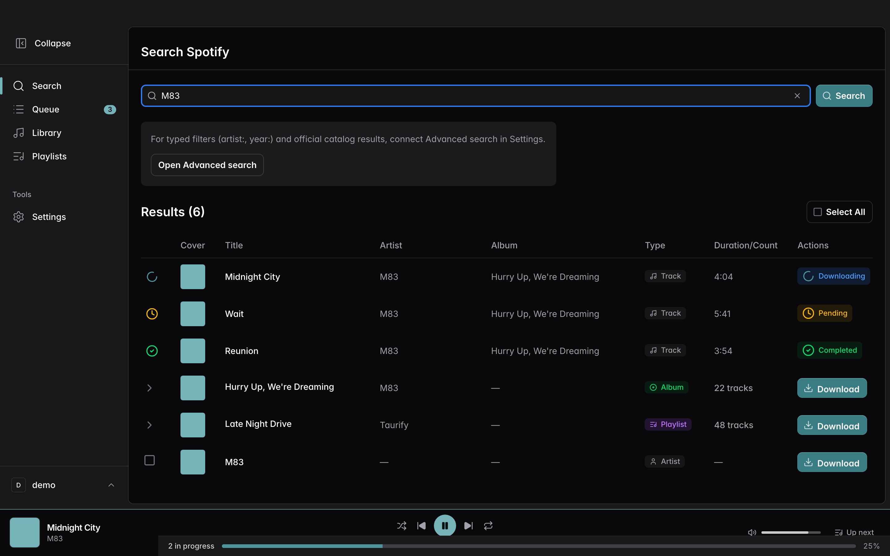
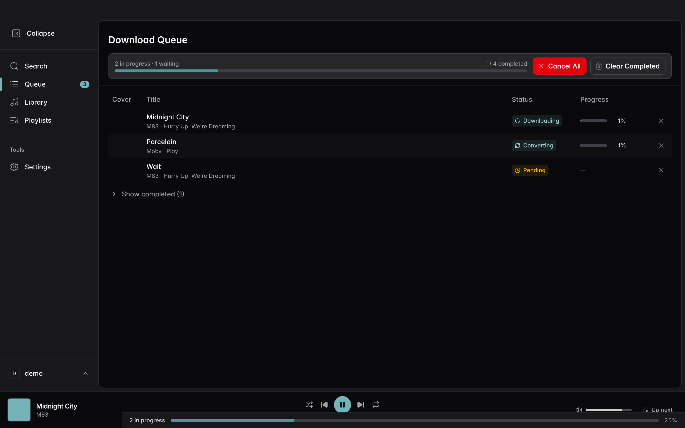
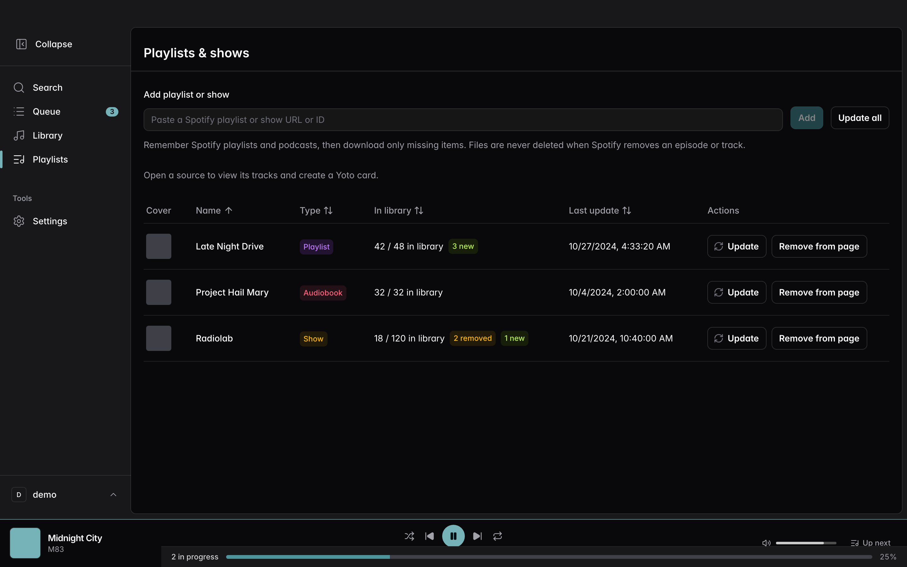
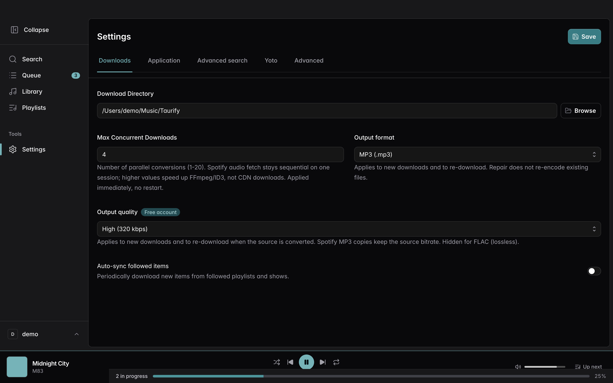
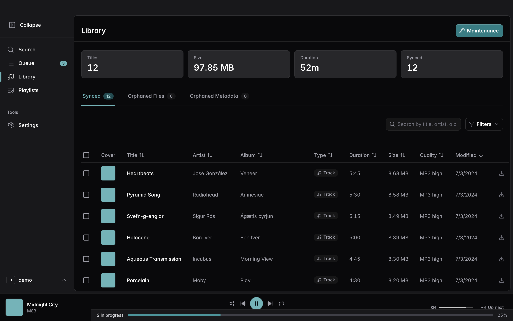

# Taurify

**[English](README.md)** · **[Français](README.fr.md)**

Téléchargez des titres, albums, playlists, podcasts et livres audio Spotify sur votre ordinateur — en MP3, AAC ou FLAC — avec une application de bureau claire pour macOS et Windows.

**[Télécharger la dernière version](https://github.com/Taurify-app/taurify-releases/releases/latest)**

| Plateforme | Fichier |
| --- | --- |
| **macOS** (Apple Silicon) | `Taurify_*_aarch64.dmg` |
| **Windows** | `Taurify_*-setup.exe` (un `.msi` est aussi fourni) |

Sous macOS, le premier lancement peut nécessiter un clic droit → **Ouvrir**.

---

## Captures d’écran

  

  
  &nbsp;
  

  
  &nbsp;
  

  

---

## Fonctionnalités

- **Recherche & URLs** — Parcourez le catalogue Spotify, ou collez un lien de titre / album / playlist / show / livre audio
- **Téléchargements fiables** — File d’attente avec progression, retries, et sortie MP3 / AAC / FLAC avec métadonnées et pochette
- **Bibliothèque** — Retrouvez tout ce que vous avez enregistré, contrôlez la qualité, organisez vos fichiers
- **Suivre playlists & shows** — Mémorisez des sources et ne téléchargez que ce qui manque (aucune suppression de fichiers à la mise à jour)
- **Lecteur intégré** — Écoutez vos fichiers locaux ou streamez depuis Spotify dans la même barre
- **Votre langue** — Interface multilingue, thèmes clair et sombre
- **Mises à jour** — Vérifiez les nouvelles versions depuis l’app (installeurs signés depuis ce dépôt)

---

## Premiers pas

1. Téléchargez l’installeur pour votre système depuis la [dernière release](https://github.com/Taurify-app/taurify-releases/releases/latest)
2. Ouvrez Taurify et connectez votre compte Spotify
3. Cherchez un titre ou collez une URL Spotify, puis téléchargez
4. Retrouvez vos fichiers dans la page Bibliothèque (et dans le dossier choisi dans Réglages)

---

## Avertissement

Taurify est destiné à un **usage personnel**. Respectez les [conditions d’utilisation de Spotify](https://www.spotify.com/legal/end-user-agreement/) et le droit d’auteur en vigueur dans votre pays. Les mainteneurs ne sont pas responsables d’un usage abusif.

Ce dépôt héberge **uniquement les installeurs**. Il ne contient pas le code source de l’application.
