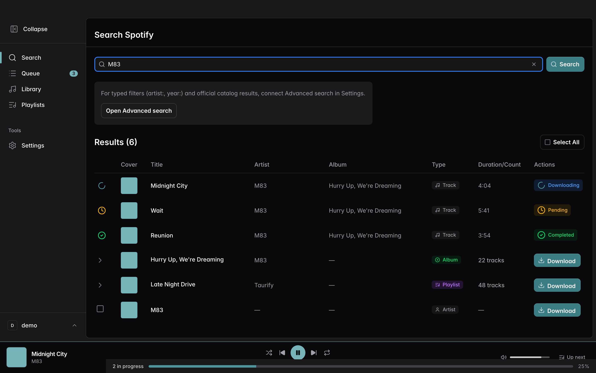
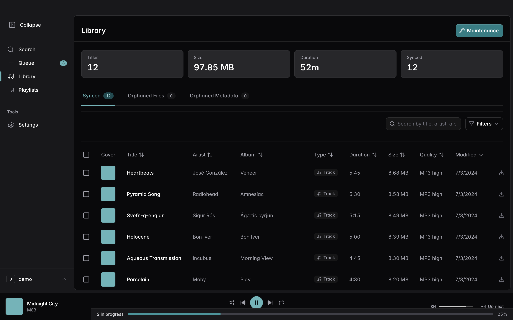
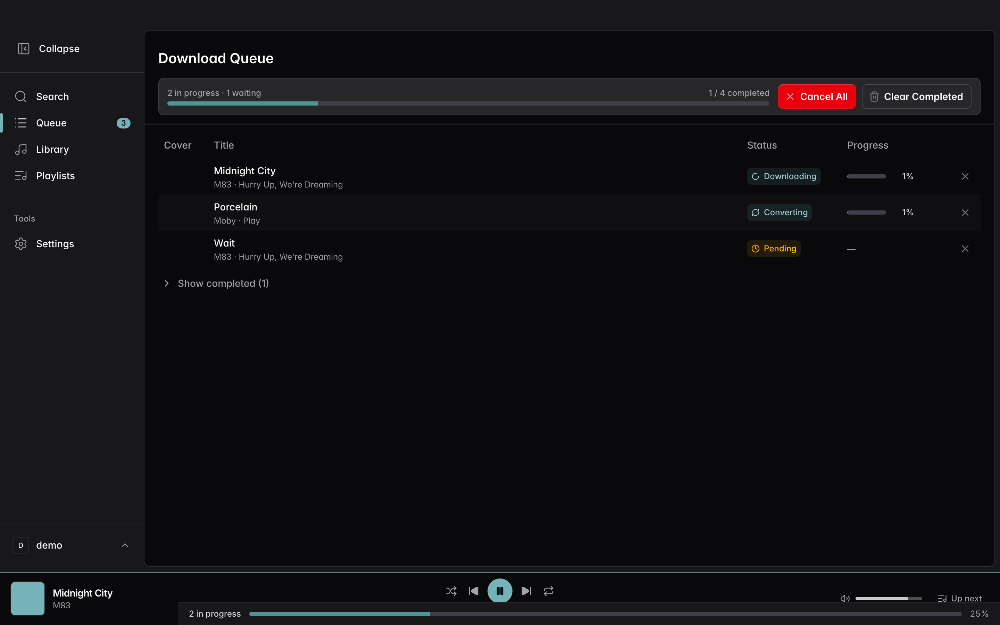
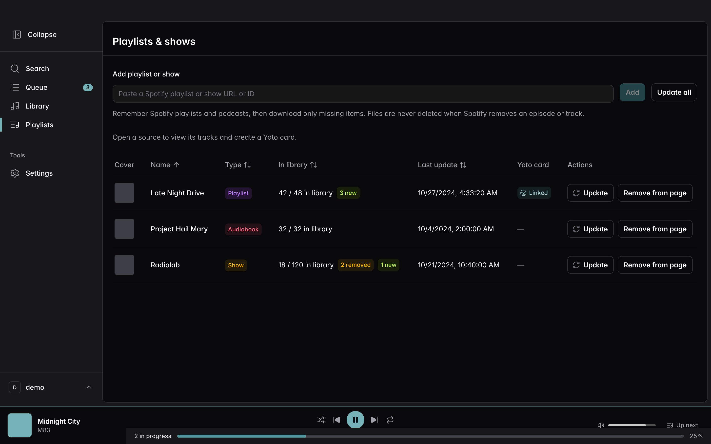
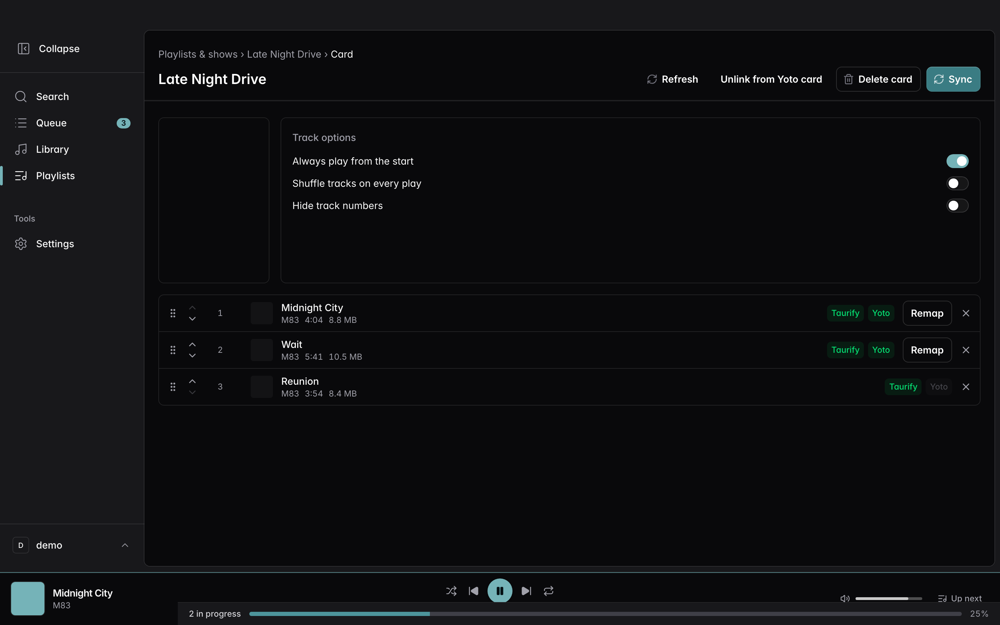
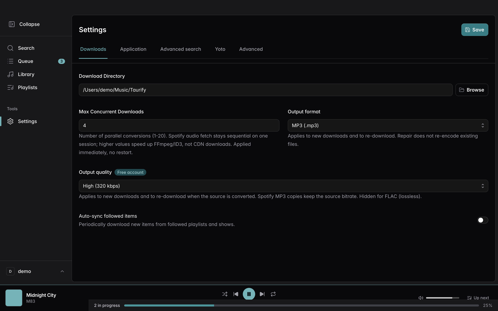

# Taurify

**[English](README.md)** · **[Français](README.fr.md)**

Download Spotify tracks, albums, playlists, podcasts, and audiobooks to your computer — as MP3, AAC, or FLAC — with a clean desktop app for macOS and Windows.

**[Download the latest release](https://github.com/Taurify-app/taurify-releases/releases/latest)**

| Platform | File |
| --- | --- |
| **macOS** (Apple Silicon) | `Taurify_*_aarch64.dmg` |
| **Windows** | `Taurify_*-setup.exe` (an `.msi` is also attached) |

On macOS, the first launch may require a right-click → **Open**.

---

## Screenshots

  

  
  &nbsp;
  

  
  &nbsp;
  

  
  &nbsp;
  

---

## Features

- **Search & URLs** — Find music in the Spotify catalog, or paste a track / album / playlist / show / audiobook link
- **Downloads that finish** — Queue with live progress, retries, and MP3 / AAC / FLAC output with metadata and artwork
- **Library** — Browse everything you’ve saved, check quality, and keep files organised
- **Follow playlists & shows** — Remember sources and download only what’s missing (files are never deleted on Update)
- **Yoto cards** — Link a followed playlist to a Yoto card, map tracks, and sync audio to the player
- **Built-in player** — Play local files or stream from Spotify in the same bar
- **Your language** — UI available in many languages, with light and dark themes
- **Updates** — Check for new versions from inside the app (signed installers from this repository)

---

## Getting started

1. Download the installer for your OS from the [latest release](https://github.com/Taurify-app/taurify-releases/releases/latest)
2. Open Taurify and connect your Spotify account
3. Search for a title or paste a Spotify URL, then download
4. Find your files in the Library page (and in the folder you chose in Settings)

---

## Disclaimer

Taurify is for **personal use**. Respect [Spotify’s Terms of Service](https://www.spotify.com/legal/end-user-agreement/) and copyright law in your country. The maintainers are not responsible for misuse.

This repository hosts **installers only**. It does not contain application source code.
